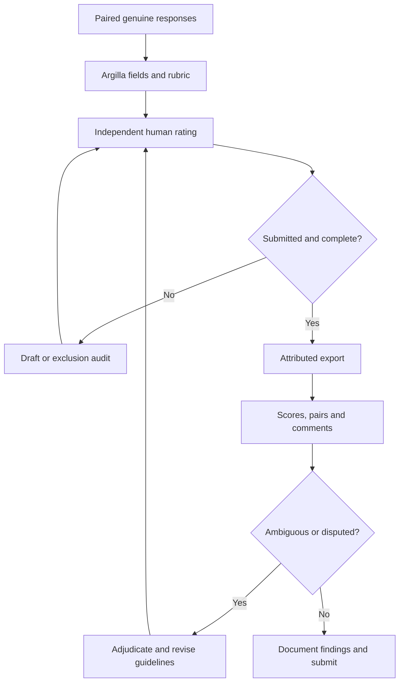

# Human-in-the-loop Evaluations Extra

**Prepared solution package with an executed synthetic demo.** The task is to evaluate energy-themed Python answers using Argilla and a cumulative0-7 rubric. The included20 candidate answers and reference scores are authored synthetic examples. They are not actual provider outputs, real human annotations, or a remote Argilla export. Live Space deployment, colleague guideline review, genuine annotation and GitHub submission remain pending.

Folder name: `lab_human_in_loop_walid_barakat`. Argilla Space URL: **not created / not supplied**. Record the real URL in this README after deployment; do not submit a placeholder.

## Start here: offline demo

Use Python3.11 or newer. From the extracted lab folder:

```bash
python -m venv .venv
source .venv/bin/activate
# Windows PowerShell: .venv\Scripts\Activate.ps1
python -m pip install -r requirements.txt
python -m src.workflow demo
python -m src.workflow config
python -m unittest discover -s tests -v
```

Demo mode needs no keys, makes no remote calls, regenerates synthetic fixtures, and writes the root `annotated_dataset.csv`, `annotated_dataset.json` and one-paragraph `lab_summary.md`. **Rerunning demo after a live export replaces those root files with demo files.** Keep live originals under `outputs/live/` and inspect provenance before submission. The notebook defaults to this same offline mode. Its cells were executed sequentially in a shared Python process; native Jupyter startup was blocked by this environment's socket restrictions.

Demo results:20 reference-labelled records,10 paired prompts, mean4.25/7, median5, range0-7. Candidate A wins5 prompts and B wins5; average A-B difference is-0.30. These numbers only check the analysis pipeline. They establish no model ranking, human judgment quality, or inter-annotator reliability.

## Complete the actual Argilla workflow

1. **Deploy the Space.** Follow `docs/space_setup.md` and the official Argilla quickstart deployment template. Sign in to your Hugging Face account, choose appropriate visibility, and verify the running Argilla UI. Record its actual `https://...hf.space` URL. The package does not publish a Space or change account settings automatically.
2. **Configure secrets.** Copy `.env.example` to `.env` and set `ARGILLA_API_URL`, `ARGILLA_API_KEY` and workspace. For a private Space also set `HF_TOKEN`. Keep `.env` out of GitHub. The default workspace is `argilla`, not an assumed nonexistent `default` workspace.
3. **Supply genuine model responses.** Use your previous provider outputs or optionally run the generator below. Preserve exactly what the model returned, pair responses on the same instruction, and keep prompt/provider/run metadata separately. The generator uses two system-prompt variants; if model IDs are equal it compares prompt variants, not different models. It makes20 logical provider requests before SDK retries and can incur cost. It does not create annotations.
4. **Review the rubric.** Ask a real colleague to read `annotator_guidelines.md`, record feedback in `docs/guideline_review.md`, and run an independent3-record pilot. Do not use synthetic reference labels while making genuine judgments.
5. **Create the configured dataset.** Test connection and create once. Choose `--min-submitted 2` at creation only if two real annotators will participate. Dataset names and records are never deleted by these scripts; use a new dataset name for changed responses/configurations.
6. **Test a small upload.** Upload2 records, verify fields/questions/guidelines in the UI, submit a pilot annotation, and export. Then upload the full dataset. Stable IDs allow repeated uploads to reuse identical records, but changed text/metadata is rejected to protect annotations.
7. **Annotate in the UI.** Read the prompt, response and validation context, check ordinary/edge behavior in a suitable isolated environment, fill all six questions and click **Submit**. Drafts are excluded. Complete all20 or a declared representative sample of at least5-10 examples; document selection and coverage. Do not treat a model suggestion as an independent human rating.
8. **Export and analyze.** Download records with user responses, preserve status/attribution, filter to complete submitted response groups, and inspect comments, distributions and paired comparisons. Export rewrites root CSV/JSON/summary with live results. Check actual provenance and add a sentence about the specific live failure modes observed.
9. **Submit.** Add actual Space URL, permitted screenshots/evidence, real exports and completed review record to a dedicated lab-only GitHub repository. Submit its repository URL. The lab requires GitHub, not a standalone ZIP or cloud document.

```bash
cp .env.example .env
# Edit locally, then:
python -m src.workflow connect
# Optional real generation; requires OPENAI_API_KEY and incurs provider cost:
python -m src.generate_responses
# Or prepare data/live/evaluation_records.json from your existing LLM outputs.
python -m src.workflow create
python -m src.workflow upload --input data/live/evaluation_records.json --limit 2
# Verify UI and pilot annotation before full upload:
python -m src.workflow upload --input data/live/evaluation_records.json
# After completing actual human annotations:
python -m src.workflow export
```

For a representative pilot export, coverage will be below100%; preserve that fact. If no complete submitted responses exist, export keeps a raw backup and stops analysis with a clear error. Do not rename a draft or synthetic fixture into a human result. Optional live commands are present in the notebook behind `RUN_LIVE=False`.

## Data and analysis design

Input JSON is a list of records with `record_id`, `prompt_id`, `candidate_alias`, `topic`, `data_origin`, `instruction`, `response`, `validation_context`. Each record shows one response, so20 response records represent10 paired prompts. Actual model names are kept out of the displayed fields. Randomized input order reduces position effects; this alone does not make annotation bias-free.

Required questions are code_quality0-3, documentation0-2, examples0-2, primary_issue, evaluation_confidence, comment. Total is calculated after export. The CSV has one row per **record and annotator**. Responses are joined by IDs, never question order. The live export uses individual `rg.Response` objects to preserve submitted/draft status, which the SDK2.8 `to_list()` representation alone does not include. Suggestions are kept separately.

Overall and candidate statistics first average across annotators within each record, then weight each record equally. A prolific reviewer does not give a record extra influence. Score/issue histograms count annotation rows, with that denominator named explicitly. Candidate comparison uses only matched A/B prompts and reports its matched count. Empty or missing pairs do not become ties. Agreement is reported only when at least two annotators rated a record; otherwise it is null. The simple exact-total agreement measure is descriptive, not a chance-corrected reliability statistic, and identical totals can hide component disagreements.

## Workflow



## File map

| Path | Purpose |
| --- | --- |
| `annotator_guidelines.md` | Required Step4 guideline document, rubric, examples, edge cases, quality controls |
| `dataset_config.md`, `dataset_settings.json` | Required Step5 configuration description and machine-readable settings description |
| `annotated_dataset.csv`, `annotated_dataset.json` | Required export filenames; currently synthetic demo, replaced by live export |
| `lab_summary.md` | Required root one-short-paragraph analysis; currently explicitly demo |
| `reflection.md` | Optional reflection, with no invented human experience |
| `src/workflow.py` | Connect, configure, create, upload, preserve responses, validate/export/analyze |
| `src/make_demo.py` | Reproduce20 synthetic candidates and reference fixtures |
| `src/build_reports.py` | Regenerate demo PDF/HTML/plots from retained demo outputs; run from this lab root |
| `src/generate_responses.py` | Optional actual OpenAI outputs, provider metadata, failure audit; no automatic run |
| `notebooks/human_in_loop_evaluation_solution.ipynb` | Executed offline notebook with all nine steps and opt-in live commands |
| `data/demo/` | Synthetic raw candidates and synthetic reference fixtures, kept separate |
| `data/live/` | Input format instructions and a five-record blank annotation template for planning; genuine outputs go here |
| `outputs/demo/` | Metrics, per-record scores, candidate stats, paired comparison, raw fixtures and exclusion audit |
| `outputs/live/` | Destination for genuine Argilla exports and analysis |
| `docs/space_setup.md` | Hugging Face/Argilla setup and persistence checks |
| `docs/guideline_review.md` | Pending colleague review and pilot evidence record |
| `docs/data_dictionary.md` | Input/export structure and score definitions |
| `docs/requirements_checklist.md` | Nine steps, remaining live evidence and submission checklist |
| `docs/live_evidence.md`, `docs/evidence/` | Actual evidence record and screenshot destination, currently pending |
| `docs/verification.md`, `docs/test_results.txt` | Offline execution, test scope and limitations |
| `docs/sources.md` | Reputable primary source links |
| `human_in_loop_solution_report.pdf` | Blue six-page report documenting the demo and actual completion steps |
| `human_in_loop_demo_report.html` | Self-contained, searchable demo results report |
| `figures/` | Exact demo score distribution and paired comparison plots |
| `tests/` |16 offline tests including SDK schema validation under mocked HTTP |
| `requirements.txt`, `.env.example`, `.gitignore` | Tested dependencies, secret placeholders, exclusions |

## GitHub-only submission

Review all files before publication. Include the required guidelines, configuration, actual annotated dataset, root summary, README and code. Keep credentials out of the repository and share raw live responses/user identifiers only when permitted. The packaged PDF/HTML remain demo reports even after a live CLI run; use fresh live outputs and evidence for claims of completion. Rename/update the README and completed evidence record around the actual run, then submit a real repository URL.

Sources: [Argilla quickstart](https://docs.argilla.io/latest/getting_started/quickstart/), [dataset settings](https://docs.argilla.io/latest/reference/argilla/settings/settings/), [annotation UI](https://docs.argilla.io/latest/how_to_guides/annotate/), [response export](https://docs.argilla.io/latest/how_to_guides/import_export/), and [Hugging Face storage](https://huggingface.co/docs/hub/spaces-storage). Full source list in `docs/sources.md`.
